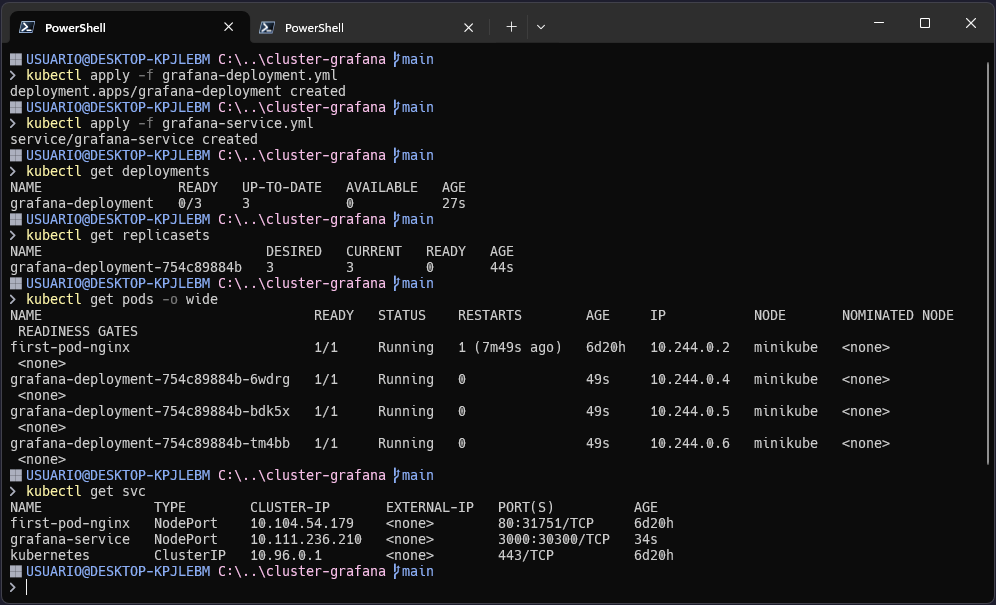
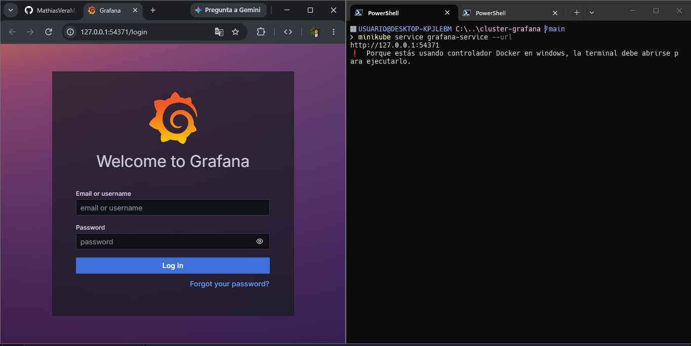
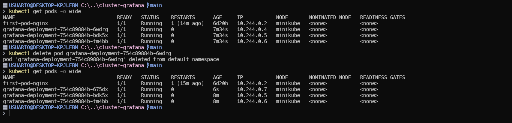
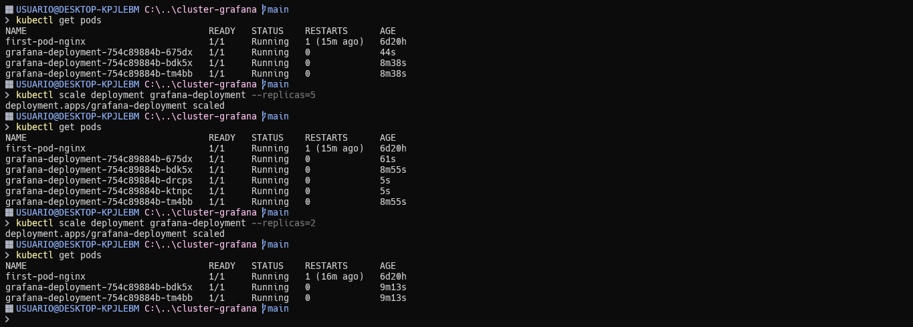
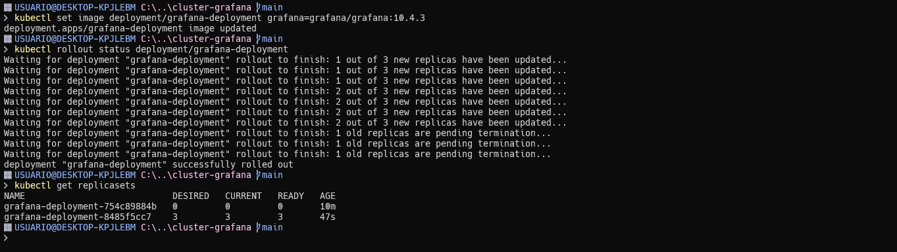
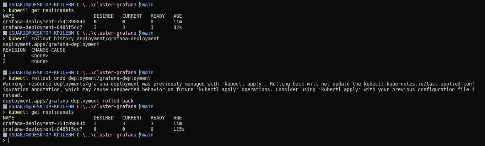
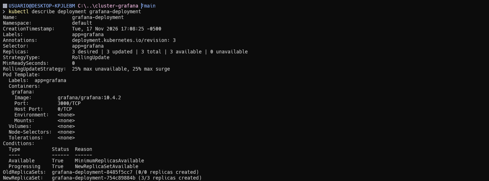
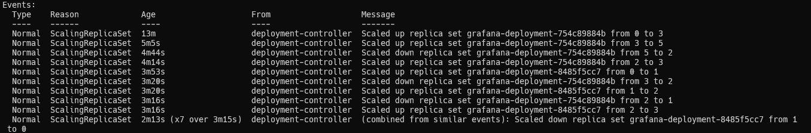

# INFORME CONFIGURACIÓN DE CLUSTER DE GRAFANA

Utilizando Deployment y ReplicaSet en Kubernetes mediante Minikube y Kubectl con la imagen de Grafana. 

**Estudiante:** Mathias Vera
**Materia:** Procesos de Software
**Repositorio:** https://github.com/MathiasVeraM/cluster-grafana

## 1. Consigna

Tenemos nuestro primer POD, ahora vamos con las funcionalidades de Deployment y ReplicaSet
 
- Despliega un POD de ElasticSearch,Redis, MongoBD,Grafana o cualquier otra plataforma diferente a la vista en clase.
- Aplica los conceptos Deployment y ReplicaSet
- Indicar qué usos puede tener

Entregables:
    Informe con link del repo (public) capturas de pantalla , evidencia la configuración y exposición de la plataforma.

## 2. Conceptos

| Concepto | Descripción |
|---|---|
| **Pod** | Unidad mínima de despliegue en Kubernetes. Agrupa uno o más contenedores. Si un Pod creado solo se elimina, no se vuelve a crear. En clase se desplegó `first-pod-nginx` de esta forma. |
| **ReplicaSet** | Garantiza que siempre exista un número determinado de réplicas de un Pod. Si un Pod falla o se elimina, crea otro automáticamente. |
| **Deployment** | Objeto de más alto nivel que crea y administra ReplicaSets. Permite escalar, actualizar con rolling update y volver a versiones anteriores. |
| **Service** | Da una dirección estable de red a un conjunto de Pods (seleccionados por etiquetas) y permite exponerlos fuera del clúster. |

Relación entre ellos:

```
Deployment  →  ReplicaSet  →  Pods  ←  Service (expone)
```

## 3. Plataforma elegida: Grafana

Grafana es una plataforma de visualización y monitoreo de métricas. Se eligió porque:

- Tiene interfaz web, lo que permite evidenciar visualmente la exposición del servicio igual que hicimos con nginx.
- Es una aplicación que, en su forma básica, funciona bien como carga de trabajo replicada.
- Es muy usada en entornos reales junto con Prometheus, Loki o Elasticsearch, me pareció importante conocer como crear un cluster de esta herramienta.

## 4. Estructura del repositorio

```
cluster-grafana/
├── capturas/
│   ├── 1.png
│   ├── 2.png
│   ├── 3.png
│   ├── 4.png
│   ├── 5.png
│   ├── 6.png
│   ├── 7.1.png
│   └── 7.2.png
├── grafana-deployment.yml
├── grafana-service.yml
└── README.md
```

## 5. Configuración

### 5.1 Deployment (`grafana-deployment.yml`)

```yaml
apiVersion: apps/v1
kind: Deployment
metadata:
  name: grafana-deployment
  labels:
    app: grafana
spec:
  replicas: 3
  selector:
    matchLabels:
      app: grafana
  template:
    metadata:
      labels:
        app: grafana
    spec:
      containers:
      - name: grafana
        image: grafana/grafana:10.4.2
        ports:
        - containerPort: 3000
```

**Explicación:**

- `apiVersion: apps/v1` y `kind: Deployment`: el objeto pertenece al grupo de API `apps`.
- `replicas: 3`: se mantienen inicialmente y siempre 3 Pods de Grafana, a menos que se lo cambie manualmente por comandos.
- `selector.matchLabels`: indica qué Pods administra este Deployment (los que tengan la etiqueta `app: grafana`). Debe coincidir con las etiquetas del `template`.
- `template`: plantilla del Pod. Es equivalente al Pod de Nginx de la clase, pero con la imagen `grafana/grafana:10.4.2` y el puerto `3000`.

### 5.2 Service (`grafana-service.yml`)

```yaml
apiVersion: v1
kind: Service
metadata:
  name: grafana-service
spec:
  type: NodePort
  selector:
    app: grafana
  ports:
  - port: 3000
    targetPort: 3000
    nodePort: 30300
```

**Explicación:**

- `type: NodePort`: expone el servicio en un puerto del nodo (en este caso, el de Minikube).
- `selector: app: grafana`: dirige el tráfico a los Pods con esa etiqueta, sin importar cuántos haya ni cómo se llamen.
- `port: 3000`: puerto del Service dentro del clúster.
- `targetPort: 3000`: puerto del contenedor al que se envía el tráfico.
- `nodePort: 30300`: puerto expuesto en el nodo.

## 6. Despliegue y exposición

### Captura 1: Creación del Deployment y del Service



**Comandos ejecutados:**

```bash
kubectl apply -f grafana-deployment.yml
kubectl apply -f grafana-service.yml
kubectl get deployments
kubectl get replicasets
kubectl get pods -o wide
kubectl get svc
```

**Qué se hizo y qué se consiguió:**

- `kubectl apply` creó los dos recursos: `deployment.apps/grafana-deployment` y `service/grafana-service`.
- `kubectl get deployments` mostró el Deployment en proceso de arranque (`0/3` listos a los 27 segundos), con 3 réplicas actualizadas.
- `kubectl get replicasets` mostró que el Deployment creó **automáticamente** un ReplicaSet (`grafana-deployment-754c89884b`) con 3 réplicas deseadas y 3 actuales. Esto demuestra que el Deployment gestiona los Pods a través de un ReplicaSet.
- `kubectl get pods -o wide` mostró los 3 Pods de Grafana en estado `Running`, cada uno con su propia IP interna (`10.244.0.4`, `10.244.0.5` y `10.244.0.6`) en el nodo `minikube`.
- `kubectl get svc` mostró `grafana-service` de tipo `NodePort`, con el mapeo `3000:30300/TCP`.

### Captura 2: Acceso a Grafana desde el navegador



**Comando ejecutado:**

```bash
minikube service grafana-service --url
```

**Qué se hizo y qué se consiguió:**

- Minikube generó la URL `http://127.0.0.1:54371`, cuyo puerto va variando cada que se ejecuta el comando, para acceder al Service. Como se usa el controlador Docker en Windows, la terminal debe permanecer abierta para mantener el túnel activo.
- Al abrir la URL en el navegador se cargó la pantalla de inicio de sesión de Grafana (`Welcome to Grafana`). Esto es la evidencia de que la plataforma quedó desplegada y expuesta correctamente.

## 7. Pruebas de las funcionalidades de Deployment y ReplicaSet

### 7.1 Autorreparación

### Captura 3: Eliminación de un Pod



**Comandos ejecutados:**

```bash
kubectl get pods -o wide
kubectl delete pod grafana-deployment-754c89884b-6wdrg
kubectl get pods -o wide
```

**Qué se hizo y qué se consiguió:**

- Se eliminó manualmente uno de los 3 Pods de Grafana para simular una falla.
- Inmediatamente después, `kubectl get pods` mostró que seguían existiendo 3 Pods: el ReplicaSet detectó que faltaba una réplica y creó un Pod nuevo (`grafana-deployment-754c89884b-675dx`, con 6 segundos de vida y una nueva IP `10.244.0.7`).
- Se comprobó que el ReplicaSet mantiene el estado deseado (3 réplicas) sin intervención manual. 

### 7.2 Escalado

### Captura 4: Escalar hacia arriba y hacia abajo



**Comandos ejecutados:**

```bash
kubectl get pods
kubectl scale deployment grafana-deployment --replicas=5
kubectl get pods
kubectl scale deployment grafana-deployment --replicas=2
kubectl get pods
```

**Qué se hizo y qué se consiguió:**

- Se partió de 3 réplicas de Grafana.
- Con `--replicas=5` el Deployment creó 2 Pods adicionales (`drcps` y `ktnpc`, con 5 segundos de vida), llegando a 5 Pods en ejecución.
- Con `--replicas=2` el Deployment eliminó 3 Pods y quedaron solo 2 (`bdk5x` y `tm4bb`).
- Se demostró que la cantidad de instancias se puede aumentar o reducir con un solo comando, útil para responder a más o menos demanda según se necesite.

### 7.3 Actualización progresiva

### Captura 5: Cambio de versión de la imagen



**Comandos ejecutados:**

```bash
kubectl set image deployment/grafana-deployment grafana=grafana/grafana:10.4.3
kubectl rollout status deployment/grafana-deployment
kubectl get replicasets
```

**Qué se hizo y qué se consiguió:**

- Se actualizó la imagen del contenedor de `grafana/grafana:10.4.2` a `10.4.3`.
- `kubectl rollout status` mostró cómo los Pods se reemplazaron de a poco (1 de 3, luego 2 de 3, y al final esperando la terminación del último Pod antiguo) hasta confirmar `successfully rolled out`. Así el servicio no se interrumpe durante la actualización.
- `kubectl get replicasets` mostró dos ReplicaSets: el nuevo (`8485f5cc7`) con 3 réplicas y el anterior (`754c89884b`) con 0 réplicas. El Deployment conserva el ReplicaSet viejo para poder volver atrás.

### 7.4 Reversión (rollback)

### Captura 6: Historial y rollback



**Comandos ejecutados:**

```bash
kubectl get replicasets
kubectl rollout history deployment/grafana-deployment
kubectl rollout undo deployment/grafana-deployment
kubectl get replicasets
```

**Qué se hizo y qué se consiguió:**

- `kubectl rollout history` mostró las revisiones 1 y 2 del Deployment (la columna `CHANGE-CAUSE` aparece como `<none>` porque no se anotó el motivo del cambio).
- `kubectl rollout undo` revirtió el Deployment a la versión anterior. Kubernetes mostró una advertencia indicando que, como el recurso se creó con `kubectl apply`, el rollback no actualiza la anotación `last-applied-configuration`. Por eso, en un entorno real se recomienda volver a aplicar el archivo YAML original en lugar de usar `undo`.
- Después del rollback, `kubectl get replicasets` mostró que los roles se invirtieron: el ReplicaSet `754c89884b` (versión 10.4.2) volvió a tener 3 réplicas y el `8485f5cc7` (versión 10.4.3) quedó en 0.

### 7.5 Descripción detallada del Deployment

### Captura 7.1: `kubectl describe deployment`





**Comando ejecutado:**

```bash
kubectl describe deployment grafana-deployment
```

**Qué se hizo y qué se consiguió:**

Se consultó la configuración y el estado completo del Deployment. Los datos más relevantes son:

- **Replicas:** 3 deseadas, 3 actualizadas, 3 en total, 3 disponibles y 0 no disponibles.
- **StrategyType:** `RollingUpdate`, con `25% max unavailable` y `25% max surge` (límites que controlan cuántos Pods pueden estar caídos o adicionales durante una actualización).
- **Imagen:** `grafana/grafana:10.4.2` (confirma que el rollback funcionó) y puerto `3000/TCP`.
- **Annotations:** `deployment.kubernetes.io/revision: 3`, es decir, el rollback generó una nueva revisión.
- **OldReplicaSets:** `grafana-deployment-8485f5cc7 (0/0)` y **NewReplicaSet:** `grafana-deployment-754c89884b (3/3)`.

La sección `Events` es la bitácora de todo lo realizado, registrada por el `deployment-controller`:

1. Creación inicial: el ReplicaSet `754c89884b` pasó de 0 a 3 réplicas.
2. Escalado: de 3 a 5 y luego de 5 a 2 réplicas, y después nuevamente a 3.
3. Rolling update: el ReplicaSet `8485f5cc7` subió de 0 a 3 mientras el `754c89884b` bajó de 3 a 0, de forma gradual.
4. Rollback: el proceso se invirtió y el ReplicaSet `8485f5cc7` se redujo a 0 mientras el `754c89884b` volvió a 3.

Esto confirma que todos los cambios fueron coordinados por el Deployment a través de sus ReplicaSets.

## 8. Usos de Deployment y ReplicaSet

### Deployment

- **Despliegues declarativos y versionados:** el estado deseado se describe en un YAML y se guarda en un repositorio.
- **Actualizaciones sin tiempo de inactividad** mediante rolling update.
- **Rollback rápido** a versiones anteriores cuando una actualización falla.
- **Escalado** manual o automático (junto con el Horizontal Pod Autoscaler).
- **Ideal para aplicaciones sin estado (stateless):** APIs REST, frontends web, microservicios, servidores web como Nginx, herramientas como Grafana.

### ReplicaSet

- **Alta disponibilidad:** mantiene siempre el número de réplicas definido.
- **Autorreparación:** reemplaza Pods que se eliminan o fallan.
- **Base del escalado horizontal:** distribuye la carga entre varias réplicas.
- Normalmente no se crea directamente: lo administra un Deployment.

### Usos de Grafana como plataforma

- Dashboards de monitoreo de infraestructura y aplicaciones.
- Visualización de métricas, logs y trazas (con Prometheus, Loki, Elasticsearch, etc.).
- Configuración de alertas y notificaciones.

### Consideración sobre el estado

Esta práctica usa Grafana con su configuración por defecto, que guarda datos en una base SQLite dentro de cada Pod por facilidad. Por eso, cada réplica tiene su propio estado y los datos se pierden si el Pod se elimina. Para un uso en producción se recomienda una base de datos externa (por ejemplo PostgreSQL) o un volumen persistente.

## 9. Conclusiones

- Un Pod solo no se recupera ante fallas; un Deployment con ReplicaSet sí, manteniendo el número de réplicas deseado.
- El Deployment crea y gestiona los ReplicaSets de forma automática, y conserva los anteriores para permitir el rollback.
- El escalado y las actualizaciones progresivas se realizan con un solo comando y sin interrumpir el servicio.
- El Service de tipo NodePort permitió acceder a Grafana desde el navegador, independientemente de qué Pods estuvieran activos.
- Para el rollback y el control de cambios en un entorno real conviene mantener los YAML en el repositorio y usar `kubectl apply`, además de registrar la causa de cada cambio.

## 10. Enlace del repositorio

https://github.com/MathiasVeraM/cluster-grafana